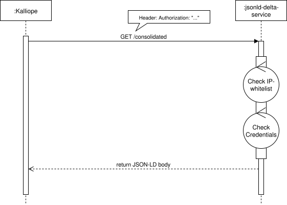

# JSON-LD Delta Service

Provides a JSON-LD representation of the consolidated [delta-notifier](https://github.com/mu-semtech/delta-notifier) messages.
The services is based on the [mu-javascript-template](https://github.com/mu-semtech/mu-javascript-template).

## Configuration

### Add JSON-LD Delta Service to the stack

The following assumes a [semantic works application stack](https://semantic.works/docs)

Include the service in `docker-compose.yml`.

```
  jsonld-delta-service:
    image: lblod/jsonld-delta-service:1.0.0
    volumes:
      - ./data/files:/share
      - ./config/kalliope:/config
    environment:
      SECURITY_CONFIG_PATH: "/config/security.json"
      DUMP_SUBJECT: "http://data.lblod.info/datasets/delta-producer/dumps/OrganizationsCacheGraphDump"
    links:
      - db:database
```

### Configure the dispatcher

Add the jsonld-delta-service routes to the [dispatcher](https://github.com/mu-semtech/mu-dispatcher) configuration.
e.g.:

```elixir
match "/consolidated/*path", %{ layer: :api_services, accept: %{ json: true } } do
  forward conn, path, "http://jsonld-delta-service/consolidated/"
end
```

### Add security config

#### 1. Create the Configuration File:

- Create a file at `/config/kalliope/security.json`
- Paste the following:

```json
{
  "enabled": true,
  "allowedIpAddresses": [
    "127.0.0.1",
    "172.18.0.0/16"
  ],
  "authSource": "/config/source.json",
  "authOutput": "/config/output.json"
}
```

#### 2. Initialize Credentials (First-time Setup):

- If this is the first time the application is being started on server, you need to create the credentials.
- Create a file at `/config/kalliope/source.json`
- Add the user credentials (modify the values as needed). This file will be automatically deleted at startup and replaced with an encrypted version located at `/config/kalliope/output.json`.

**Example of `/config/kalliope/source.json`:**

```json
[
  {
    "username": "boris",
    "password": "5678"
  },
  {
    "username": "nordine",
    "password": "1234"
  }
]
```

### Boot up the system

Boot your microservices-enabled system using docker-compose.

    cd /path/to/mu-project
    docker-compose up

You can shut down using `docker-compose stop` and remove everything using `docker-compose rm`.

## Usage

### `/consolidated`

The JSON-LD response contains:

- A named graph with the consolidated representation of all delta messages. i.e. the result of applying all inserted and delete messages.
- The default graph contains a timestamp to be used in subsequent requests

```json
   ...
],
"@id": "http://mu.semte.ch/graphs/kalliope/consolidated",
"date": "2021-05-27T09:26:03.351256816Z",
  "@context": {
    "date": {
      "@id": "http://purl.org/dc/terms/date",
      "@type": "http://www.w3.org/2001/XMLSchema#dateTime"
    }
  }
}
```

## Security mechanisms

